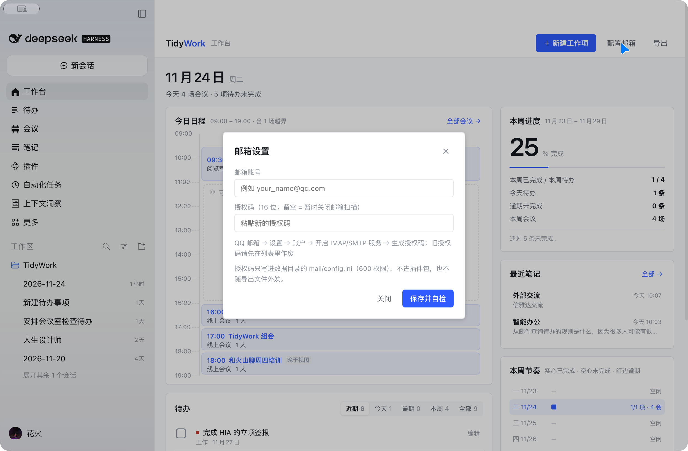

# TidyWork · DSH 上的个人工作台

给 [DeepSeek Harness（DSH）](https://github.com/deepseek-ai) 桌面版加一个工作台插件：侧边栏多出 **工作台 / 待办 / 会议 / 笔记** 四块，工作台一屏看完今天的日程与待办；再把 QQ 邮箱接进来，邮件里的待办与会议邀请会自动落到看板上。

**形态**：DSH 插件组合包（`dsh.bundle.patch` 机制），不 fork、不改 DSH 源码。宿主升级，插件照用。
**当前版本**：v3.42.0（`share-desktop/VERSION`、`tidywork-plugin/package.json` 同步）

## 界面概览

```
┌──────────┬───────────────────────────────┬──────────────────┐
│ 侧边栏    │ 11月24日 周二                  │ 本周进度  25%     │
│ 工作台    │ 今天 4 场会议 · 5 项待办未完成   │ 已完成/待办 1/4   │
│ 待办      ├───────────────────────────────┤ 最近笔记          │
│ 会议      │ 今日日程 09:00–19:00           │ 外部交流 10:07    │
│ 笔记      │  09:30 █ 需求评审 3F 会议室 6 人 │ 周报草稿 10:03    │
│ 插件      │  11:00 ░ 可专注 11:00–16:00    │                  │
│ 自动化任务 │  16:00 █ 版本上线评审 线上      │ 本周节奏          │
│ 上下文洞察 │  17:00 █ 项目周会 线上         │ 11/23 —          │
│           │  18:00 █ 培训沟通 线上 ⚠越界    │ 11/24 1/1 项·4会 │
│ 工作区     ├───────────────────────────────┤ 11/25 —          │
│ TidyWork  │ 待办 近期6 今天1 逾期0 本周4 全部9│ ...             │
│  2026-11-24│ ☐ 整理季度总结 11/27          │                  │
└──────────┴───────────────────────────────┴──────────────────┘
```

左栏是今天（时间轴 + 待办），右栏是这周（进度环 / 最近笔记 / 节奏点阵），顶栏只有「＋ 新建工作项」「配置邮箱 / 扫描邮箱」「导出」三个动作。



*邮箱设置：未配置时顶栏显示「配置邮箱」，弹窗只填账号与授权码，保存即跑自检。*

> 公开仓库只放这张截图——其他界面截图里是本机真实会议与待办，不入库。

## 它是什么，不是什么

| | 说明 |
|---|---|
| 是 | 一个能一屏看清「今天怎么排、这周推进到哪」的工作台，数据落本地 JSON，可导出、可备份 |
| 是 | 一个把邮件变成待办 / 会议邀请的抽取器，抽出来的条目和手输的进同一份清单 |
| 是 | 宿主开放能力的入口：会话里用自然语言增删改、让模型调工具、挂自动化任务 |
| 不是 | 不是 fork 出来的另一个 DSH——原生对话、插件、自动化、设置全保留 |
| 不是 | 不是只有四块页面的「待办 App」——没有固定形状的任务在会话里完成，结果回写看板 |

## 功能

**工作台**：今日日程时间轴（默认 09:00–18:00，会议超范围自动扩展、块高按真实时长、重叠分栏、越界角标、当前时刻线）+ 待办清单（近日 / 今天 / 逾期 / 本周 / 全部，行内新增、点勾即完成）+ 右栏本周进度、最近笔记、七天节奏点阵。

**待办**：搜索、五种排序（智能 / 截止日 / 优先级 / 标题 / 创建顺序）、优先级三档、分类、删除可撤销。

**会议**：结构化起止时间、状态每分钟重算、卡片可编辑、「转待办」把会后跟进落到清单；邮件邀请可直接「接受 / 拒绝」。

**笔记**：Markdown 实时渲染（Vditor `ir`，点哪句编哪句、光标行露源码）、标签 / 置顶 / 搜索 / 大纲、20 个版本快照可回滚、图片粘贴上传、连续图片自动聚合成画廊网格、点击图片打开灯箱（缩放 / 平移 / 切换）、表格支持 `=` 公式求值（`SUM/AVG/MAX/MIN/COUNT` 与单元格 / 范围引用，结果只读展示、源码保留）、可导出 PDF、`todo:` / `meeting:` 内链、`- [ ]` 一键转待办；只保留这一种写法，顶栏没有模式切换与格式化按钮（格式靠 Markdown 语法与编辑器快捷键，专注 / 打字机可开可关，资源本地随包分发，断网可用）。

**邮箱**：IMAP 读近 7 天邮件与日历 → 抽待办 / 会议 → 按 `mailKey` 投影进看板，重复扫描不重复记；顶栏一个按钮（未配置 =「配置邮箱」，已配置 =「扫描邮箱」），凭据落数据目录且不进安装包。

**飞书**：自建应用 + 长连接，私聊/群里 @ 提问 → 在 TidyWork 工作区建/续会话作答，回复发回飞书；早报、待办到期、会前 N 分钟推送到飞书，时间与免打扰可配。DSH 需保持运行，凭据落数据目录。详见 [docs/飞书联动.md](docs/飞书联动.md)。

**会话入口**：「＋ 新建工作项」回到 TidyWork 工作区当天会话（标题 `yyyy-mm-dd`，同日复用），系统提示已交代好归类规则，进去直接说「明天下午三点跟产品过一版」就行。

**运维**：`/health` 探活、`/export` 一键导出、日志按 1MB 轮转。

## 两种装法

### A. 桌面版（推荐，已有 DSH 桌面版）

```bash
bash build-desktop-package.sh          # 生成 dist/TidyWork-DSH桌面插件-v3.42.0.zip
```

解压后按系统运行 `安装-mac.command` 或 `安装-windows.bat`，装完重开 DSH，侧边栏即出现四块入口。安装包只带 `config.example.ini` 模板，不含任何账号凭据；数据落在 `~/.dsh/profiles/desktop/tidywork`，换包不丢。

卸载与重装见 `share-desktop/说明.md`。

### B. Docker 单容器（自带 DSH web）

```bash
cp .env.example .env                   # DeepSeek Key 可留空，启动后在 Models 页登录
docker compose up -d --build
# 打开 http://localhost:3080，首次访问地址见 data/context/dsh-web-url.txt
```

端口被占用就改 `.env` 的 `DSH_WEB_PORT`。数据都在 `./data`，重建容器不丢。

## 邮箱模块怎么配

顶栏点「配置邮箱」→ 填 QQ 邮箱账号 + 16 位授权码 → 「保存并自检」。授权码在 QQ 邮箱「设置 → 账户 → 开启 IMAP/SMTP 服务」里生成，旧的先在列表里作废。授权码留空 = 暂停扫描。

- 凭据写在 `~/.dsh/profiles/desktop/tidywork/mail/config.ini`（600 权限），不进插件包、不随导出外发。
- 弹窗每次打开现拉状态，不回填默认账号；「清除已保存的账号」可一键抹掉。
- **授权码等同密码**：如果曾通过聊天、截图、压缩包外发过，请立刻在邮箱后台作废重发。

## 飞书怎么配

顶栏点「飞书」→ 填 App ID / App Secret → 「保存并连接」。飞书侧要先建企业自建应用：开机器人能力、消息收发权限、订阅 `im.message.receive_v1` 并选「长连接」，发布版本审批通过后才会生效。逐步清单与排查表见 [docs/飞书联动.md](docs/飞书联动.md)。

- 私聊直接答；群里默认必须 @ 才答，可关。
- 每个私聊/群内每个人对应一条 TidyWork 会话，续聊复用。
- 提醒时间自定义：早报、待办提醒、会前提前分钟、免打扰区间；发过消息的会话自动成为推送目标。
- 凭据写在 `~/.dsh/profiles/desktop/tidywork/feishu/config.json`（600 权限）。

## 架构

```
DSH 宿主（Electron / web）
  ├─ 原生侧边栏：工作台 · 待办 · 会议 · 笔记（本插件注册的面板）
  ├─ 原生对话 / 插件 / 自动化任务 / 设置        ← 全部保留，不接管
  └─ tidywork-plugin
       ├─ 服务端半 lib/index.js   /tidywork-api（webServer 路由 + guardRequest 来源校验）
       ├─ 客户端半 lib/client.js  四块面板 + 工作台布局，走 ctx.layout.selectPanel
       ├─ lib/mail.js             引擎调度、字段映射、投影 upsert、5 个 Agent 工具
       └─ engine/                 Python 子进程：IMAP / SMTP / CalDAV（标准库即可跑扫描）
数据：<dataRoot>/todos.json · meetings.json · notes.json（正文 notes/<id>.json）· mail/config.ini
```

几处关键取舍：

- **来源校验**：所有写操作校验 Host 白名单、Origin 同源、`Sec-Fetch-Site`，且必须 `application/json`，挡掉网页 CSRF；错误统一分码（400/403/404/409/413/415/500），超长字段明确报错而不是静默截断。
- **落盘**：按资源串行写 + 临时文件 rename 原子落盘；笔记正文与索引分离，列表页不读全文；附件按引用回收、32 位 hex 命名。
- **引擎解耦**：Python 只负责邮件协议，输出结构化 JSON；Node 侧 `execFile` + 子命令白名单 + 参数校验，不拼 shell；引擎崩了不拖垮宿主。
- **一份数据两个入口**：界面走 HTTP，模型走工具（`tidywork_mail_scan/list/rsvp/done/add` + `tidywork_add_todo/meeting/note`），写的是同一份文件，不会「对话改了看板没变」。
- **确定性归插件，开放性归宿主**：四块看板有 schema、有口径、有视图，适合硬编码；研究、写作、代码、长链路自动化这些没有固定形状的任务留给会话与宿主编排，结果通过工具回写。所以加需求的第一选择是加工具、补提示，而不是加页面。

## 目录结构

```
tidywork-assistant/
├── tidywork-plugin/        # 插件源码（真正的实现）
│   ├── lib/index.js        #   服务端：/tidywork-api 路由、来源校验、工具注册、系统提示
│   ├── lib/client.js       #   客户端：四块面板 + 一屏工作台
│   ├── lib/mail.js         #   邮箱：引擎调度、字段映射、投影、工具
│   ├── engine/             #   Python 邮箱引擎（IMAP/SMTP/CalDAV，todo-scan/list/…）
│   ├── locale/zh.json      #   文案
│   └── config.example.ini  #   凭据模板（只有占位值）
├── share-desktop/          # 桌面分发包：安装/卸载脚本、VERSION、plugin/（打包副本）
├── tests/                  # 30 项单测（server + mail）
├── build-desktop-package.sh# 打包：同步 engine → 语法检查 → dist/*.zip
├── docker-compose.yml      # 单容器部署
├── Dockerfile
├── docs/                   # 截图、变更日志、设计文档
└── data/                   # 运行数据（不入库）
```

## HTTP 接口

均需 DSH web 登录态；写请求要求 `content-type: application/json`。

| 路径 | 方法 | 作用 |
|---|---|---|
| `/tidywork-api/todos` | GET/POST | 列表（`view=all/today/week/late/category`）/ 新增 |
| `/tidywork-api/todos/:id` | PATCH/DELETE | 局部更新 / 删除 |
| `/tidywork-api/meetings` `.../:id` | GET/POST/PATCH/DELETE | 会议增删改查（`month=YYYY-MM`） |
| `/tidywork-api/notes` `.../:id` | GET/POST/PATCH/DELETE | 笔记增删改查 |
| `/tidywork-api/notes/:id/restore` | POST | 版本回滚 |
| `/tidywork-api/attachments` | POST | 笔记图片上传（正文只存 URL） |
| `/tidywork-api/mail/status` | GET | 邮箱是否已配置 |
| `/tidywork-api/mail/scan` | POST | 扫描邮箱并投影（串行执行） |
| `/tidywork-api/mail/rsvp` | POST | 会议邀请接受 / 拒绝 |
| `/tidywork-api/mail/config` | POST | 保存账号与授权码（`clear` 可清除） |
| `/tidywork-api/recycle` | GET | 回收站列表（`ttlDays` 附保留天数） |
| `/tidywork-api/recycle/restore` | POST | 从回收站恢复原条目（同类已存在返回 409） |
| `/tidywork-api/recycle/:id` | DELETE | 彻底删除（笔记同时清理正文与图片） |
| `/tidywork-api/import` | POST | 导入 JSON（同 id 跳过，单条非法只跳过该条） |
| `/tidywork-api/export` | GET | 整库导出 JSON |
| `/tidywork-api/health` | GET | 自检：版本、数据目录、各服务状态 |

## 测试与打包

```bash
node --test tests/*.test.mjs     # 30 项全过
bash build-desktop-package.sh    # 产物：dist/TidyWork-DSH桌面插件-v3.33.2.zip
```

> Node 22 下别用 `node --test tests/`（会被当成模块路径），用上面的通配写法。

## 数据与备份

桌面版：`~/.dsh/profiles/desktop/tidywork`；Docker：`./data`。
工作台顶栏「导出」可下载整库 JSON；笔记、待办、会议都能单独删除并撤销。

## 常见问题

| 现象 | 处理 |
|---|---|
| 扫描按钮点了没反应 / 报错 | 多半是没配置或授权码失效，会直接弹设置窗并给原因；先确认邮箱后台 IMAP 已开 |
| 卡片上的「✉ 邮箱」标 | 表示这条是邮件抓来的，鼠标悬停看主题与发件人；手工条目没有 |
| 扫描很慢 | 扫描串行拉取近 7 天邮件，邮箱越大越慢；实测 9 封约 8.7 秒 |
| 端口冲突（Docker） | 改 `.env` 的 `DSH_WEB_PORT` 后重启容器 |
| 插件没生效 | 重装后重启 DSH；或 `docker compose up -d --build`（entry.sh 会自动比对重装） |

## 文档

- [`docs/CHANGELOG.md`](docs/CHANGELOG.md)：完整版本演进（v3.7 → v3.33.2）
- [`share-desktop/说明.md`](share-desktop/说明.md)：桌面安装包说明（含卸载、目录、授权码位置）
- [`docs/后端数据通道.md`](docs/后端数据通道.md)：路由与数据落盘细节
- [`docs/workbench-redesign/`](docs/workbench-redesign/)：工作台改版方案与测试报告

## 许可

内部项目，未附开源许可证；如需对外发布请先确认授权范围。
